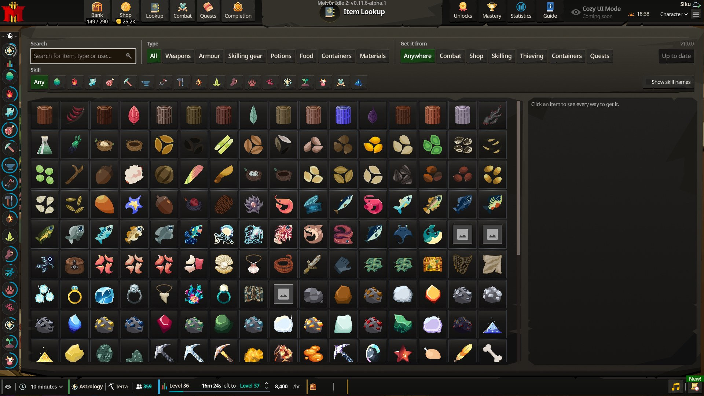
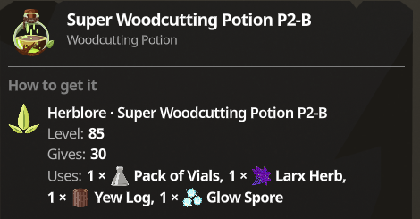
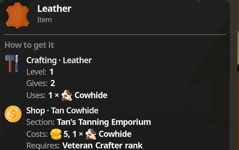
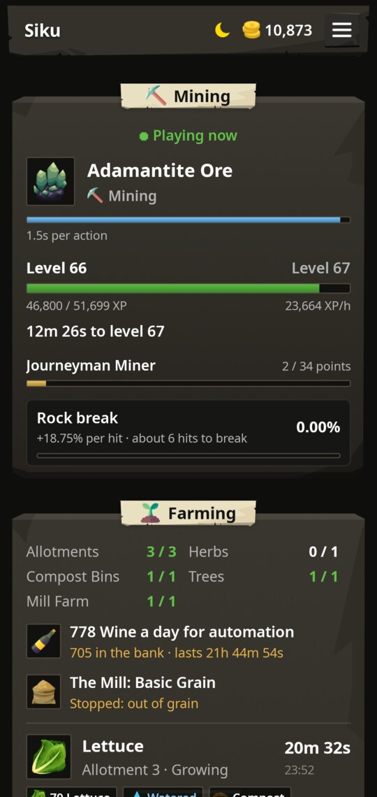
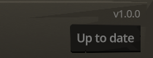

  

<h1 align="center">Melvor Mods</h1>

  <b>Mods for Melvor Idle 2 on Linux, in one installer.</b> 
  <b>Lookup</b> finds any item and every way to get it.
  <b>Timers</b> puts your skills, farms and animals on your phone.
  <b>Hide Version</b> hides the version number at the top of the screen.
  <b>Trade</b> lets you gift, ask for and trade items with your Steam friends.

  
  

  

---

## Lookup

Type what you're after, like `mining gear`, `food`, `bronze` or `potion`, or narrow it down
with the filters. Then hover an item for the game's own tooltip, or click it to see
**every way to get it**.

<table>
  <tr>
    <td width="50%" valign="top">
      <h3>Every source, at a glance</h3>
      Recipes and their ingredients, monster drops with their odds, shops and their
      prices, thieving loot, chests, quests and more. Laid out the way the game lays out
      its own tooltips.
    </td>
    <td width="50%"></td>
  </tr>
  <tr>
    <td width="50%"></td>
    <td width="50%" valign="top">
      <h3>Hover an ingredient</h3>
      Every item in a recipe or a price is the real thing: hover it for the game's
      tooltip, to see where <i>that</i> comes from.
    </td>
  </tr>
  <tr>
    <td width="50%" valign="top">
      <h3>The game's own tooltips</h3>
      Hover any item in the results for the same tooltip the Bank shows: stats,
      bonuses, what it's used in.
    </td>
    <td width="50%"></td>
  </tr>
  <tr>
    <td width="50%"></td>
    <td width="50%" valign="top">
      <h3>Prices and requirements</h3>
      Costs in gold and items, levels, shop sections and what you need to unlock each
      one.
    </td>
  </tr>
</table>

**Filters** narrow things down by type (weapons, armour, skilling gear, potions, food,
containers, materials), by where an item comes from (combat, shop, skilling, thieving,
containers, quests) and by skill. A filter that would show nothing fades out, so you can
see that before you click it. **Show skill names** puts the skills' names next to their
icons.

---

## Timers

Your Melvor timers on your Android phone, styled like the game: what you're training,
your farming plots and your ranch, and a notification the moment something is ready. It
shows what the game's pages show, in the game's words. It keeps going after you close
the game and turn off your PC, the same way the game's offline progress does.

  

- **Training:** the skill's picture, animated like in the game (the rock, the tree, the
  item being made, the fishing spot, the enemy), the action bar, XP and time to the next
  level, item rates, and the skill's own page info.
- **Combat:** while the app is open, every hit, miss and respawn as it happens, both HP
  and attack bars, your food, and your Offensive Stats beside the enemy's.
- **Farming:** each plot growing or ready, with its compost, water and what's automated,
  your wine use and the mill.
- **Ranching:** the land overview, how many enclosures need repair, and each animal:
  healthy or sick, whether it wants pets, and when it dies.
- **Offline progress:** how long the game keeps catching up, and a warning before it stops.

While the app is open it updates the moment the game does. Tap the menu for a list of
the skills on screen, to jump to one.

### Set it up

You need an **Android** phone (there's no iPhone app).

1. **Install the mods** as above. Timers comes with them.
2. **In Melvor,** open **Settings** and choose **Timers**. You'll see a QR code.
3. **No app yet?** On your phone, download
   [**melvor-timers.apk**](https://melvor.sikuthenomad.com/timers/app/melvor-timers.apk)
   (or scan the code with your camera and tap **Download the app**), then open the file.
   Android asks to allow your browser to install apps once: the app isn't on the Play
   Store. Google may offer to scan it first; that's fine.
4. **Open Melvor Timers,** tap **Scan QR code**, and point it at the code in the game.
   When it says **Linked to your game**, you're done. Allow notifications when it asks.

When there's a new version, the app shows **Update ready** when you open it. Tap
**Install now** (the first time, Android asks you once to allow it), and it shows
what's new once it's updated.

### Good to know

- **Keep your code to yourself.** Anyone who scans it can see your timers. Nothing
  else: not your save, and not your account.
- To link another phone, scan the same code with it. **Link a different game** in the
  app's menu switches to someone else's code.
- The game's Settings → Timers page shows **What your phone sees**, so you can check
  both match.

---

## Trade

A **Trade** tab between Shop and Lookup, for your Steam friends who have Melvor Mods too.

- **Gift:** pick items or gold from your bank and send them. If your friend is offline,
  the gift waits for them. They accept it, or decline it and it comes back to you.
- **Ask for items:** ask a friend for something, with a note. They can give it, give
  less, offer a trade instead, or say no.
- **Trade:** while you're both in the game, each of you puts in what you're offering.
  When you've both accepted, you both see exactly what you give and get, and accept once
  more.

Nothing can be lost or doubled, even if the game closes halfway. Each change is saved in
your game before it's sent, and anything unfinished is finished the next time you play.
A big gift, like a tenth of your gold, asks "Sure?" first. Gifted items don't count as
"found", so they don't skip anyone's unlocks.

Trade signs in with your Steam account through the game, so there's nothing to set up.

---

## Hide Version

Hides the game's version number (`Melvor Idle 2: v0.11.6-alpha.1`) from the top of the
screen. That's all it does.

---

## Install

You need **Melvor Idle 2 from Steam, on Linux**. The Steam from your distribution's
packages is fine; the Flatpak version of Steam isn't supported.

1. **Download** `Install.Melvor.Mods.zip` from the
   [latest release](../../releases/latest). It's under **Assets**.
2. **Extract it.** Right-click the zip in your file manager and choose
   **Extract Here** (or **Extract**).
3. **Double-click `Install Melvor Mods`.** If your file manager asks whether to run
   it or open it, choose **Run**. A progress window shows each step.
   - **Melvor is open?** It offers **Restart now**: the game saves, closes, and starts
     again with the mods. Or choose **Continue**, and they appear the next time you
     start the game.
   - **It asks to restart Steam?** Click **Restart Steam**. Steam only takes the new
     launch option when it restarts. This only happens on some setups.
4. **Done.** Click **Start game**. The **Lookup** tab is in the game's top bar,
   between **Shop** and **Combat**, and **Timers** is in the game's **Settings**.

From then on they keep themselves up to date. Already had Melvor Lookup installed? It
updates itself to Melvor Mods, Timers included: nothing to do.

---

## Updates

New versions download by themselves while you play. When one is ready, the button at
the top right of the Lookup page turns green:

  
  &nbsp;&nbsp;&nbsp;
  

Click **Restart to update**, then **Sure?**. The game saves, syncs to the cloud and
restarts into the new version. Not now? Just keep playing: it switches over the next
time you start the game anyway. Hover **Up to date** to see what's new in your
version.

---

## Reinstall or uninstall

Double-click `Install Melvor Mods` again:

  

- **Reinstall** (or **Update**, with a newer installer) puts a fresh copy in place.
- **Uninstall** removes the mods and puts their files in the trash. Your game and
  save aren't touched.

---

## Troubleshooting

<b>The Lookup tab doesn't show up</b>

- Restart the game once: the tab appears when you load your character.
- Check the launch option is there. In Steam, right-click **Melvor Idle 2**, then
  **Properties**, then **General**, then **Launch Options**. It should start with
  `LD_PRELOAD=` and mention `melvor-lookup`. If it doesn't, run the installer and
  choose **Reinstall**.
- Right after a game update, the tab may stay away until a fixed version arrives. The
  game itself keeps working normally.

<b>"Error Saving Game: Failed to write cloud save"</b>

That's the game's own cloud save failing, usually a network hiccup on the game's
side, not the mod. Click **Try Again** until it goes through. Don't pick **Exit without
Saving** unless you mean to lose your progress since the last save.

<b>Something else is wrong</b>

The mod keeps a log at `~/.local/share/melvor-lookup/log.txt`. Send it along with what
happened.

<b>How it works</b>

The installer puts the mods' files in `~/.local/share/melvor-lookup/mod/` and adds
their loader to Melvor Idle 2's launch options in Steam, keeping any options you
already had. Each time the game starts, the mods read what they need from your own
copy of the game, so they ship none of the game's files and keep up with game updates.
Updates are signed, and the mods only install ones signed by their author.

Timers sends your timers to a small server, and your phone fetches them from there.
The server keeps only your latest timers and the game's pictures, under your private
code, and tells your phone when something changes. While the app is open, the game also
sends moments like combat hits through it; those go straight to the app and aren't kept.

---

  A fan-made mod. Not affiliated with Games by Malcs. Melvor Idle and its artwork
  belong to their owners. The screenshots are from the game with this mod installed.

