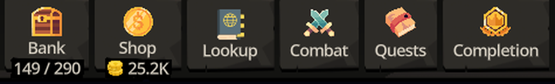
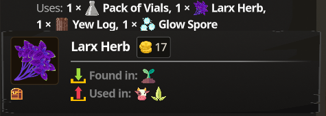
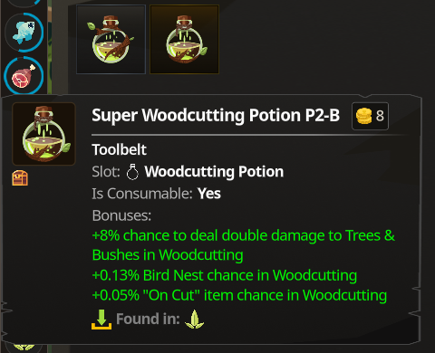
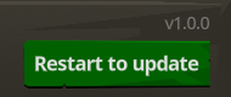
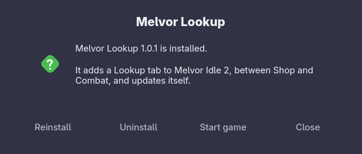

  

<h1 align="center">Melvor Lookup</h1>

  <b>Find any item in Melvor Idle 2, and every way to get it.</b> 
  A Lookup tab built into the game's own interface, for Linux.

  

  

---

## What it does

Type what you're after, like `mining gear`, `food`, `bronze` or `potion`, or narrow it down
with the filters. Then hover an item for the game's own tooltip, or click it to see
**every way to get it**.

<table>
  <tr>
    <td width="50%" valign="top">
      <h3>Every source, at a glance</h3>
      Recipes and their ingredients, monster drops with their odds, shops and their
      prices, thieving loot, chests, quests and more. Laid out the way the game lays out
      its own tooltips.
    </td>
    <td width="50%"></td>
  </tr>
  <tr>
    <td width="50%"></td>
    <td width="50%" valign="top">
      <h3>Hover an ingredient</h3>
      Every item in a recipe or a price is the real thing: hover it for the game's
      tooltip, to see where <i>that</i> comes from.
    </td>
  </tr>
  <tr>
    <td width="50%" valign="top">
      <h3>The game's own tooltips</h3>
      Hover any item in the results for the same tooltip the Bank shows: stats,
      bonuses, what it's used in.
    </td>
    <td width="50%"></td>
  </tr>
  <tr>
    <td width="50%"></td>
    <td width="50%" valign="top">
      <h3>Prices and requirements</h3>
      Costs in gold and items, levels, shop sections and what you need to unlock each
      one.
    </td>
  </tr>
</table>

**Filters** narrow things down by type (weapons, armour, skilling gear, potions, food,
containers, materials), by where an item comes from (combat, shop, skilling, thieving,
containers, quests) and by skill. A filter that would show nothing fades out, so you can
see that before you click it. **Show skill names** puts the skills' names next to their
icons.

---

## Install

You need **Melvor Idle 2 from Steam, on Linux**. The Steam from your distribution's
packages is fine; the Flatpak version of Steam isn't supported.

1. **Download** `Install.Melvor.Lookup.zip` from the
   [latest release](../../releases/latest). It's under **Assets**.
2. **Extract it.** Right-click the zip in your file manager and choose
   **Extract Here** (or **Extract**).
3. **Double-click `Install Melvor Lookup`.** If your file manager asks whether to run
   it or open it, choose **Run**. A progress window shows each step.
   - **Melvor is open?** It offers **Restart now**: the game saves, closes, and starts
     again with the mod. Or choose **Continue**, and the tab appears the next time you
     start the game.
   - **It asks to restart Steam?** Click **Restart Steam**. Steam only takes the new
     launch option when it restarts. This only happens on some setups.
4. **Done.** Click **Start game**, and the **Lookup** tab is in the game's top bar,
   between **Shop** and **Combat**.

From then on it keeps itself up to date.

---

## Updates

New versions download by themselves while you play. When one is ready, the button at
the top right of the Lookup page turns green:

  
  &nbsp;&nbsp;&nbsp;
  

Click **Restart to update**, then **Sure?**. The game saves, syncs to the cloud and
restarts into the new version. Not now? Just keep playing: it switches over the next
time you start the game anyway. Hover **Up to date** to see what's new in your
version.

---

## Reinstall or uninstall

Double-click `Install Melvor Lookup` again:

  

- **Reinstall** (or **Update**, with a newer installer) puts a fresh copy in place.
- **Uninstall** removes the mod and puts its files in the trash. Your game and save
  aren't touched.

---

## Troubleshooting

<b>The Lookup tab doesn't show up</b>

- Restart the game once: the tab appears when you load your character.
- Check the launch option is there. In Steam, right-click **Melvor Idle 2**, then
  **Properties**, then **General**, then **Launch Options**. It should start with
  `LD_PRELOAD=` and mention `melvor-lookup`. If it doesn't, run the installer and
  choose **Reinstall**.
- Right after a game update, the tab may stay away until a fixed version arrives. The
  game itself keeps working normally.

<b>"Error Saving Game: Failed to write cloud save"</b>

That's the game's own cloud save failing, usually a network hiccup on the game's
side, not the mod. Click **Try Again** until it goes through. Don't pick **Exit without
Saving** unless you mean to lose your progress since the last save.

<b>Something else is wrong</b>

The mod keeps a log at `~/.local/share/melvor-lookup/log.txt`. Send it along with what
happened.

<b>How it works</b>

The installer puts the mod's files in `~/.local/share/melvor-lookup/mod/` and adds the
mod's loader to Melvor Idle 2's launch options in Steam, keeping any options you
already had. Each time the game starts, the mod reads the item data from your own copy
of the game, so it ships none of the game's files and keeps up with game updates.
Updates are signed, and the mod only installs ones signed by its author.

---

  A fan-made mod. Not affiliated with Games by Malcs. Melvor Idle and its artwork
  belong to their owners. The screenshots are from the game with this mod installed.

